

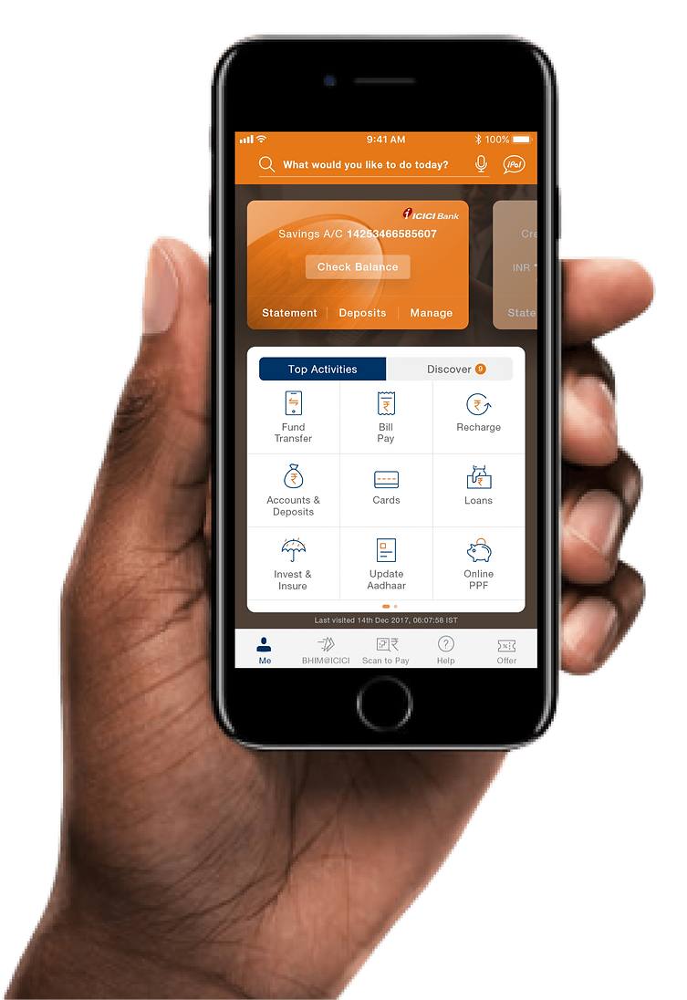

# Redesigning a mobile banking experience
### A UX case study: ICICI Bank iMobile for iOS

**Suvarna Myneni**

### [View the case study website →](https://suvarnamyneni.github.io/imobile-case-study/)

---

## At a glance

| | |
|---|---|
| **Employer** | ICICI Bank (in-house, full-time) |
| **Product** | iMobile dashboard, redesigned for iOS |
| **Role** | UX Designer at ICICI Bank. Led the research and core UX design. A first major role as a UX designer. |
| **Team** | Suvarna Myneni (research and core UX), Ravi, Salma Shaik, Priyanka Kane (PM) |
| **Duration** | 6 months |
| **Tools** | Figma, X-Mind, InVision |
| **Methods** | Research, 15 customer interviews, 3 personas, wireframes tested with 8–10 users |

ICICI Bank is India’s largest private bank, with a presence in 7+ countries. iMobile, launched in 2008 and described as India’s first mobile banking application, served over 10 million users at the time of this project. The bank’s customers, a wider group, totaled over 62 million.

The task was a user-centered iOS app that holds many banking jobs and still stays simple, accessible, and efficient for a diverse audience. I moved the balance and upcoming transactions to the top, and brought key actions out of the hamburger menu.

---

## Table of contents

- [At a glance](#at-a-glance)
- [Context](#context)
- [The challenge](#the-challenge)
- [What I knew going in](#what-i-knew-going-in)
- [Process](#process)
- [Secondary research](#secondary-research)
- [User interviews and personas](#user-interviews-and-personas)
- [Competitive landscape](#competitive-landscape)
- [Heuristic review](#heuristic-review)
- [Design objectives](#design-objectives)
- [Information architecture](#information-architecture)
- [Wireframes](#wireframes)
- [Dashboard exploration](#dashboard-exploration)
- [Solutions](#solutions)
- [Designed details](#designed-details)
- [Test, evaluate, repeat](#test-evaluate-repeat)
- [Final UI](#final-ui)
- [Outcome](#outcome)
- [What I learned](#what-i-learned)
- [What the write-up does not include](#what-the-write-up-does-not-include)

The same sections, with the screens, are on the [live site](https://suvarnamyneni.github.io/imobile-case-study/).

---

## Context

In 2008 ICICI Bank launched iMobile. The case study calls it India’s first mobile banking application. By the time of this project the app served over 10 million users. The redesign had to consider the bank’s customers across age groups, totaling over 62 million. Those two figures describe different groups: app users, and bank customers.

  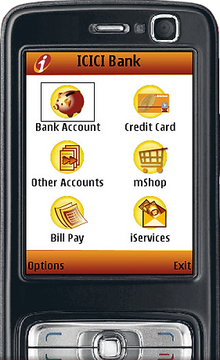

## The challenge

> ICICI Bank aimed to revamp its iMobile app for iOS, focusing on delivering an intuitive and delightful experience. My task was to design a comprehensive personal banking app that seamlessly integrates diverse functionalities while catering to a broad user base with varying financial needs. The challenge was to create a user-centric interface that balances simplicity, accessibility, and efficiency, ensuring the app remains both functional and engaging for a diverse audience.

## What I knew going in

Forrester’s analysis, as I used it on this project, found that Indian banking apps performed poorly against international ones. No Indian app surpassed the global average of **65/100**. ICICI received the highest rating among the Indian apps, **63/100**, and remained the most popular, seen as one of the best among competitors. The report’s name and year are not given.

Stakeholder interviews covered how the app worked, where it was limited, and which issues were already known. Some restrictions set by the Reserve Bank of India could not be changed.

## Process

1. **Discover and explore** — secondary research, target audience, user interviews, personas, competitor analysis, heuristic review, exploring the problems.
2. **Design** — information architecture, wireframing, prototyping.
3. **Test and evaluate** — user testing, stakeholder feedback, refine and repeat.

  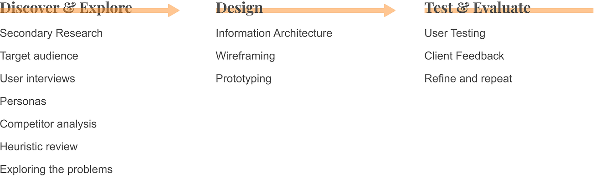

## Secondary research

A quick Google search supplied the desk research. The case study does not cite each figure.

| Finding | Share |
|---|---:|
| Used a mobile device to view a balance, view recent transactions, pay bills, transfer funds, or do other banking | 60% |
| Purchase with a mobile app | 73% |
| Want to receive personal offers | 44% |
| Wanted an alert if their credit card was up for renewal | 49% |
| Transferred funds between accounts | 44% |
| Paid a bill from their bank account | 47% |
| Reported using their bank’s mobile app | 64% |
| Wanted an alert about a problematic or fraudulent transaction | 58% |

Top activities, longest bar first, with no count printed on the bars: balance checking, account statement, recent transactions, offers and promotions, bill payment.

  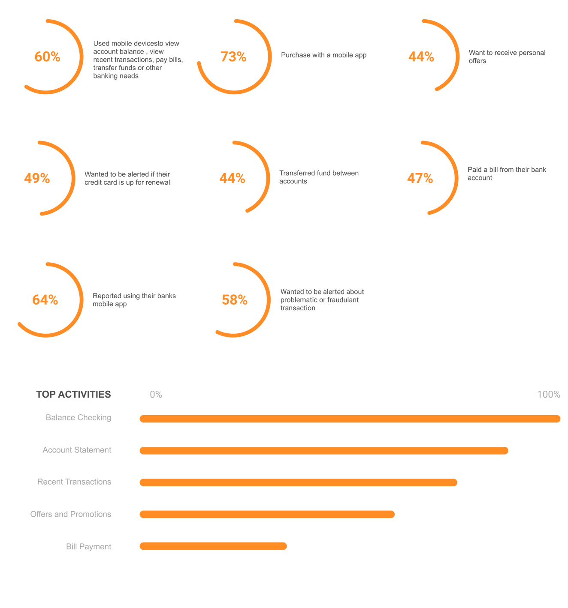

## User interviews and personas

Fifteen customer interviews: eight ICICI customers and seven customers of other banks, plus the bank’s customer data. Three personas came out of that. I also made customer journey maps and service blueprints. Those maps are not reproduced in this write-up.

| Persona | Goals | Pain points | Bars (out of 5) |
|---|---|---|---|
| **Shivnay Agarwal**, 39, data scientist. Responsible, practical, disciplined, cautious. | Instantly access all account details. Keep track of bills and pay them on time. | Hard to search for a transaction. No easy overview of all accounts. Irrelevant content. | Speed 3, Features 4, Help 3, Discover 3 |
| **Athira Menon**, 25, fashion designer. Carefree, no dependants, tech-savvy, confident. | Track expenses. Save more to travel. Quickly view funds. Day-to-day transfers. | Can’t quickly view her balance. No way to track expenses. The app is not aesthetically pleasing. | Speed 5, Features 3, Help 1, Discover 3 |
| **Hiten Shah**, 56, bank manager, retiring after 33 years. Content, not tech-savvy, jolly, weary. | Retire financially secure. Lead a hassle-free life. | Help is not easy to find. Not aware of investment opportunities. The app is not intuitive. | Speed 2, Features 2, Help 5, Discover 4 |

Shivnay: “I like to stay up to date, be it new technology or bill payments.” Athira: “I want more control over my expenses and want to save more to spend on travel.” Hiten, on the card: “I’ve seen enough and more of life. Looking for some peace and quite after retirement.” The on-page summary uses “quiet.”

  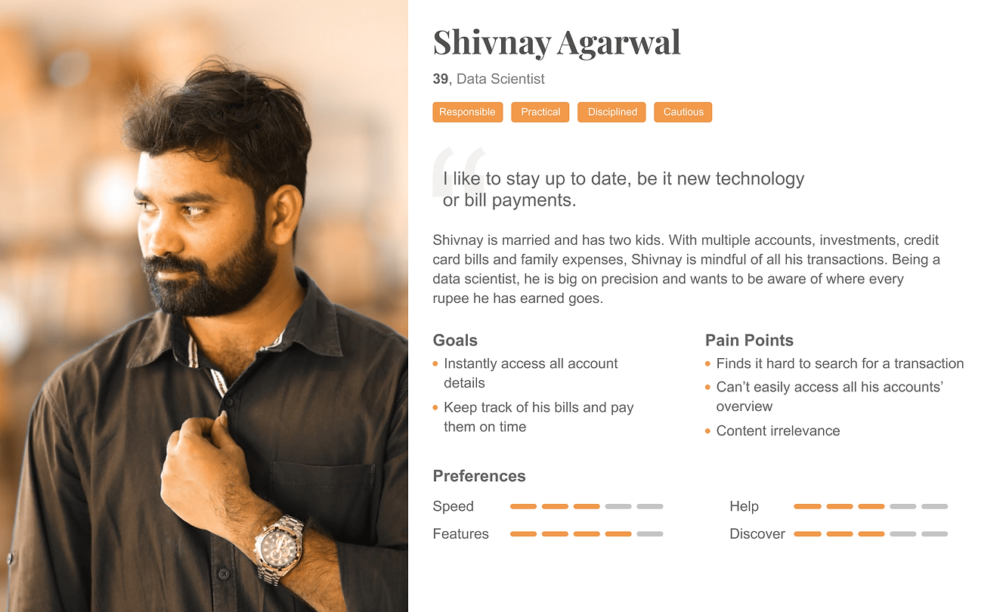 
  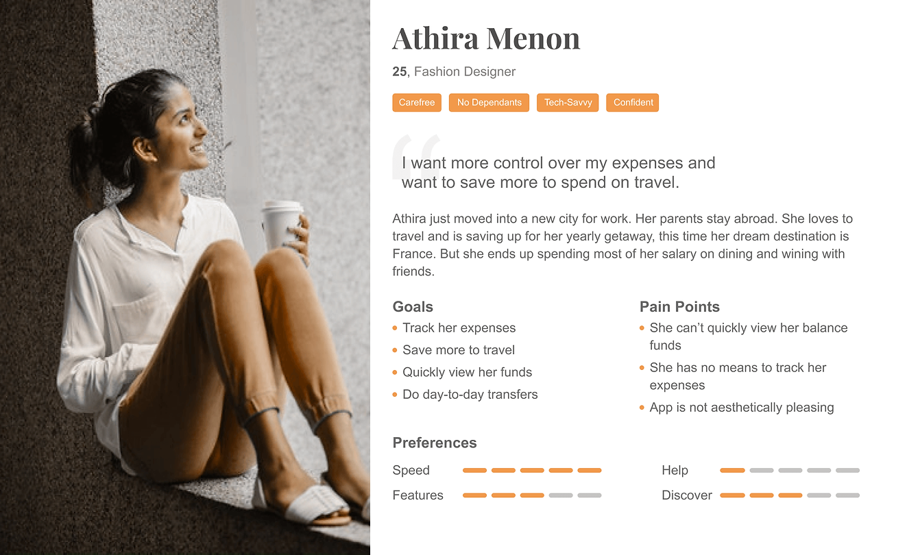 
  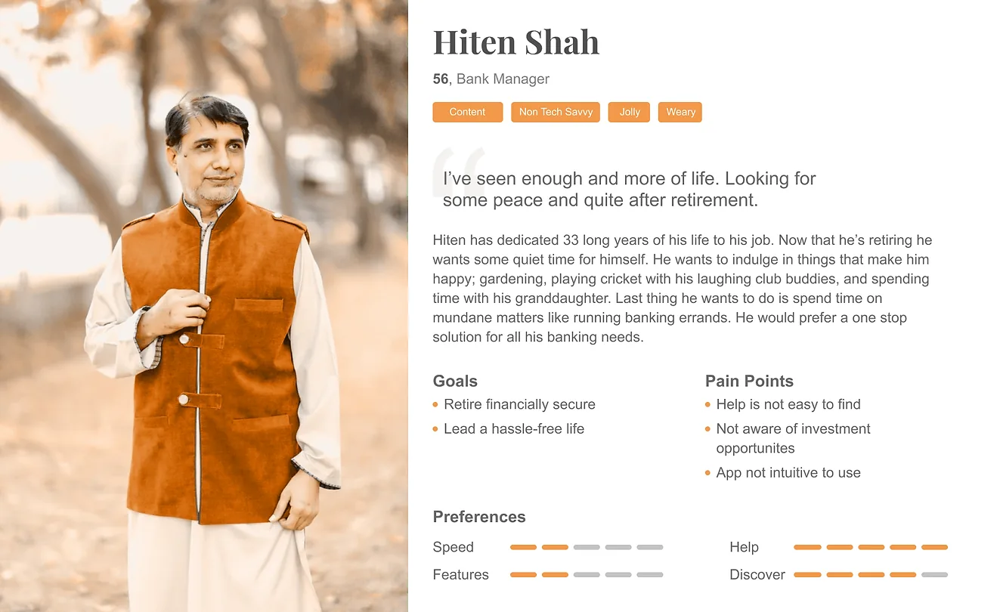

The interview guide and any affinity map are not in the write-up. The preference scores are the filled segments on each card.

## Competitive landscape

No Indian bank app, including the direct competitors HDFC and SBI, stood out as ideal in design, features, and usability. The set then widened to Paytm and Google Pay. The original notes also name Dhani and Walnut. There is no scoring matrix.

ICICI’s app was already notable for how much it held, including UPI payments, loan applications, and card design. Important functions were not easy to find.

Screens: SBI Anywhere, HDFC Bank, Paytm, Google Pay (still branded Tez on the screen), and Walnut Prime. Dhani is named and has no screen. The two Walnut Prime files are the same image.

  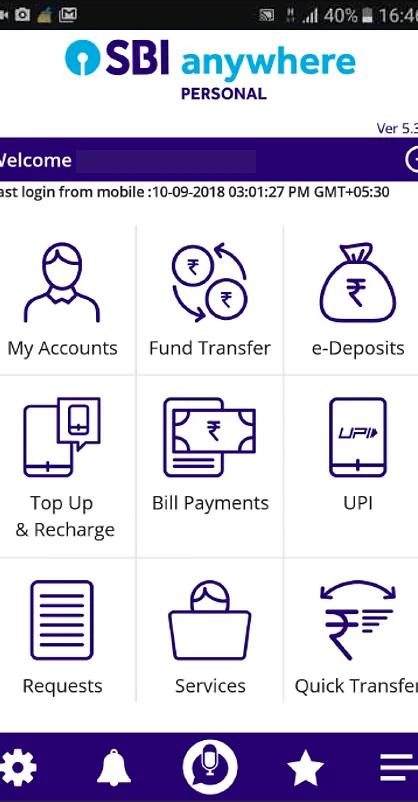
  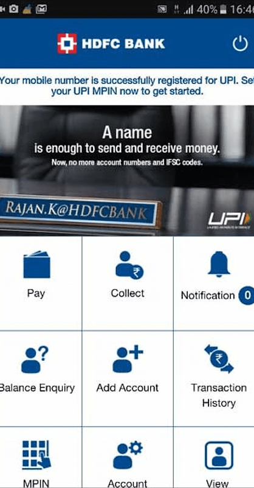
  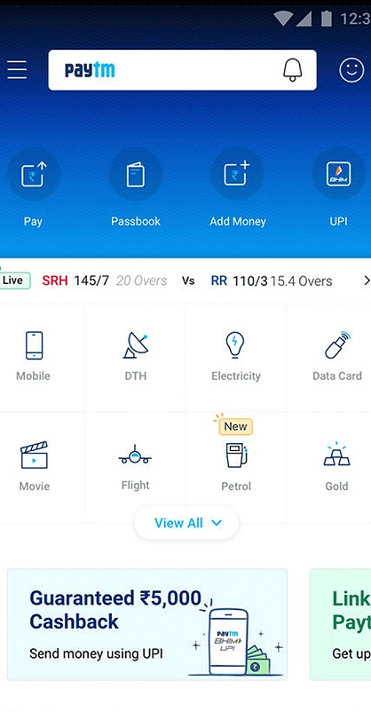
  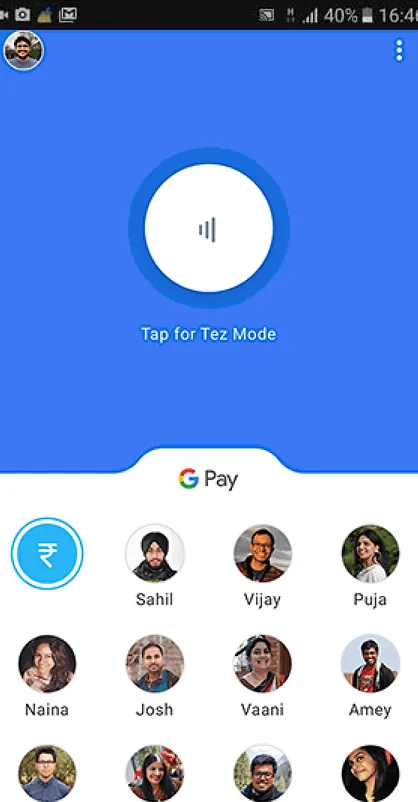
  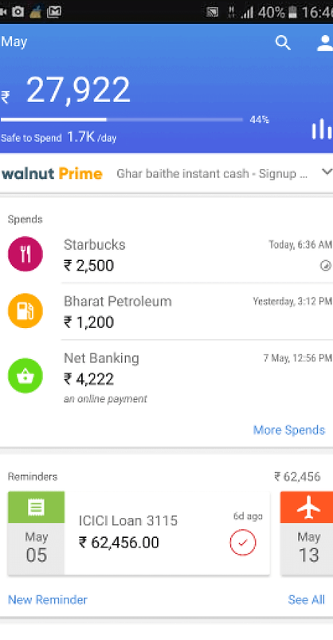

## Heuristic review

The old dashboard needed extra taps, wound the navigation around, and stretched forms out. The annotated findings:

- The layout was stagnant.
- Notifications and account updates were not visible on the dashboard.
- “My Favourite Transaction,” not used often, was too prominent.
- The grid showed many services, not ordered by that person’s usage.
- The profile area took 30 to 35 percent of the screen.
- Balance checking, the most-used action, was not on the dashboard.
- A hamburger menu hid the actions.
- There was no place to discover a new feature, and no personalized suggestion.

  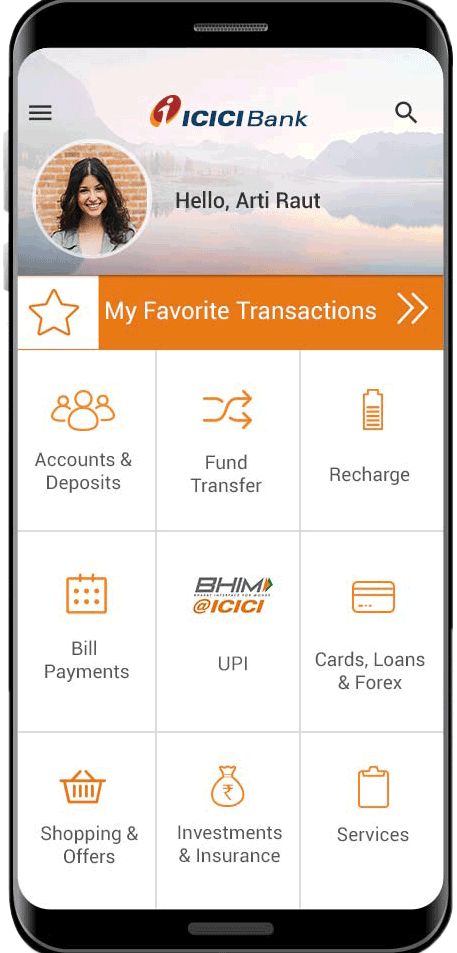

## Design objectives

1. Quick access to frequently performed actions.
2. Better feature discoverability.
3. Display user-relevant content.
4. Leverage available technology to enhance the experience.

A further principle guided the money moments: design for confidence, not just completion. Intended. It is not a measured score.

## Information architecture

Unnecessary states came out, pages moved, and three areas came in: Expenditure Analysis, Upcoming Transactions, and Discover. Frequent services sit first. Less common features stay quick to find. Adding and managing lines of credit, insurance, debit cards, and investments was streamlined, with room for a prompt that does not break the task in progress.

  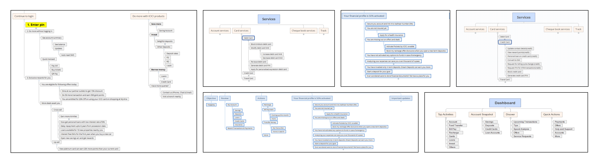

## Wireframes

Concepts covered Login, Dashboard, Accounts, Expenditure Analysis, Fund Transfer, Bill Pay, Offers, and Help. Some simpler journeys worked against the business goals of discoverability and cross-selling. The final choices had to hold both.

The annotated board is in [`images/42-wireframes-full.pdf`](images/42-wireframes-full.pdf). I tested the wireframes with 8 to 10 users.

## Dashboard exploration

The dashboard had to show the accounts a person holds, open a way into more features and products, and put repeated actions within reach. Balance sits up front, behind “tap to view balance,” because not everyone wants that number in the open. Search is visible and accepts voice input. Help stays within reach. Top Activities follows what that person does most often. The wireframes note that most people hold a single product, usually a savings account, so the layout leans on that relationship.

  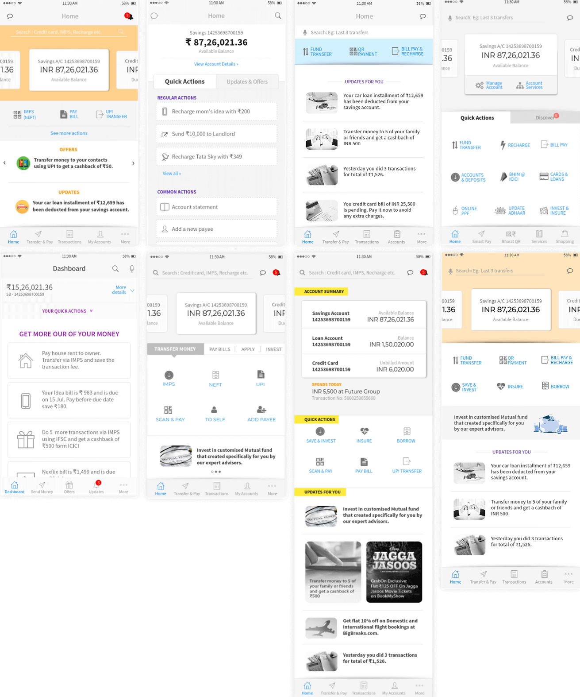

## Solutions

A vague, inconsistent transaction narration shows up more than once. Clearer narration sits under the spending views and the history.

1. **Personalized from the get-go.** The homepage follows activity. Top Activities highlights tasks the person already does. Discover introduces tools and services they have not used.
2. **Budgeting and comparisons.** Monthly expenses can be tracked, compared, and capped with a spending limit.
3. **Expenditure analysis.** A category breakdown, with an alert when a category budget is crossed.
4. **Upcoming transactions.** Recurring items such as EMIs, bills, and rent are flagged ahead of time, from the spending pattern.
5. **Transaction history.** A readable list, tagged automatically, with tags the person can edit or add, and more than one way to filter and sort.

## Designed details

From the wireframe annotations:

- Notifications, and a swipe to see the balance, without logging in. Fingerprint and Face ID for login.
- Shareable account details, with a choice of which details. Bookmarks, category edits, and a communication-address update from home. Filters include type, mode, time, amount, cheque, and history up to three years.
- A fixed deposit drawn so the money can be seen growing, plus FD advice.
- Bill categories ordered by how often that person pays them, and Auto Pay.
- Feedback as a single tap, with emoji instead of a 1-to-10 scale. Leftover questions can wait.
- Pre-approved offers on the first fold, including offers tied to place and time, with distance. Coupon codes copy on tap. An Expressions card can be previewed and swiped between designs.

## Test, evaluate, repeat

Testing was phase by phase. I refined the wireframes with the design team and with the business stakeholders before the interface was designed. Sessions used 8 to 10 users from various departments. The write-up does not list the tasks, the findings, or a success rate.

## Final UI

The final frames cover login (including “Swipe to see your balance”), the dashboard, transactions, a fixed-deposit growth chart, bill pay, emoji feedback, spending overview, service requests, upcoming transactions, the services list, iFinance cash flow, and recommendations. One home-screen mockup hides the balance behind Check Balance. Amounts and dates on the frames, including December 2017 and January 2018, are sample interface data.

  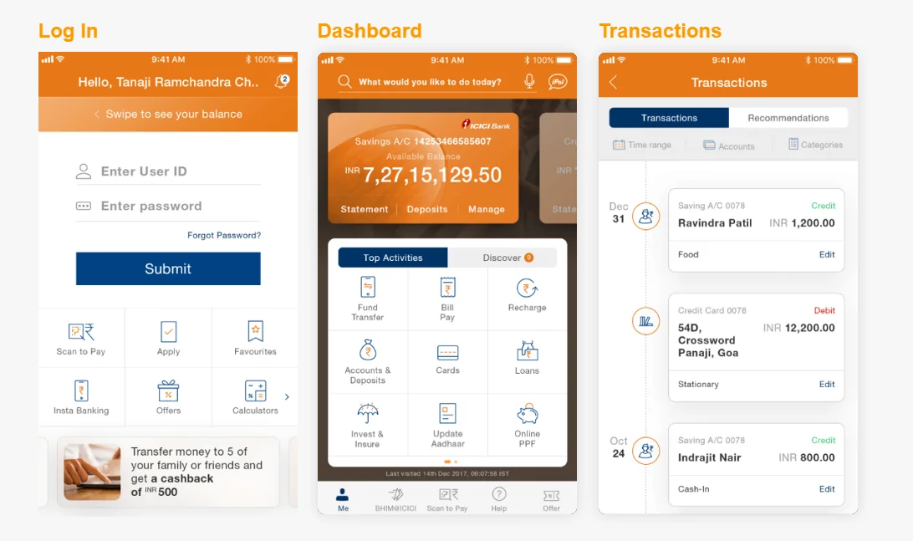 
  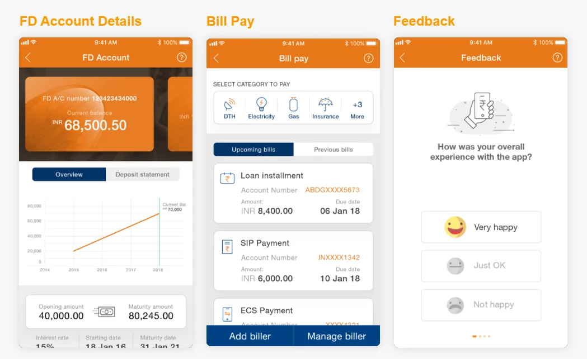 
  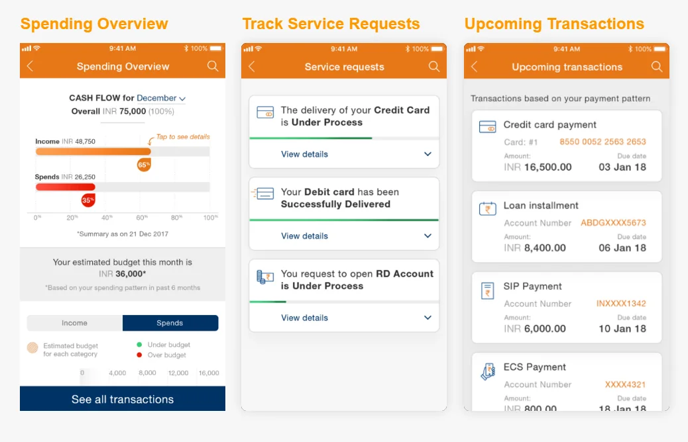

## Outcome

> The end product was what I envisioned it to be. A beautiful and functional banking app that was one-of-its-kind in India. The app allows the user to perform all primary tasks seamlessly. It also makes those not-so-commonly-used features discoverable if the user ever needs them.

To stay relevant, the design integrated payments via Siri and QR codes, login via Touch ID, Face ID, and voice recognition, and Siri-enabled in-app voice search. Intended capabilities.

The balance and upcoming transactions sit at the top. Key actions are out of the hamburger menu. No launch metric is stated.

## What I learned

> Working on this project has taught me a lot about the design thinking process, the do’s and don’ts of mobile design (especially when it comes to iOS), and the importance of not getting married to an idea.

That lesson sits inside a first major UX role, in-house at ICICI Bank. The wireframe trade-off is the same point in practice: a shorter journey still had to leave room for discoverability and for the products the bank needed people to find.

## What the write-up does not include

- A project year, or any statement of whether the redesign shipped. Sample dates on the screens are not treated as the project date.
- Post-launch metrics of any kind. Conversion, engagement, and drop-off are not stated, so they are not treated as results.
- Usability-test results, an interview guide, or a competitor scoring matrix.
- The title and year of the Forrester analysis, and a source for each desk-research statistic.
- The customer journey maps and service blueprints beyond the fact that I made them.

---

Case study by **Suvarna Myneni**. [Portfolio](https://suvarnamyneni.github.io) · [LinkedIn](https://www.linkedin.com/in/suvarnamyneni/)
